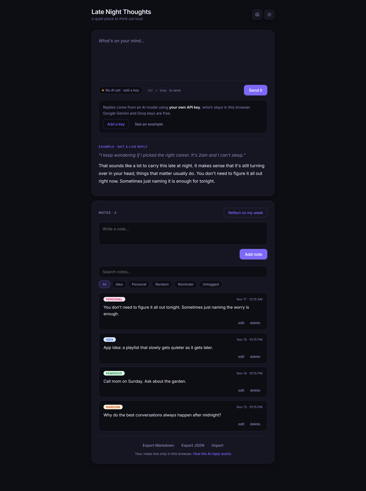
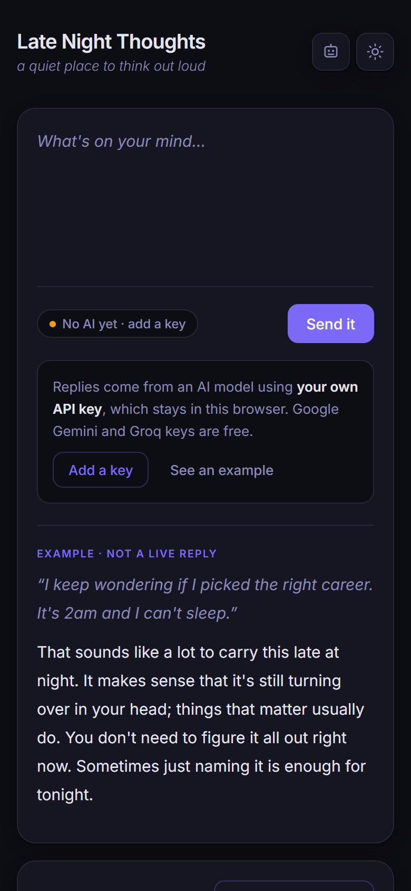
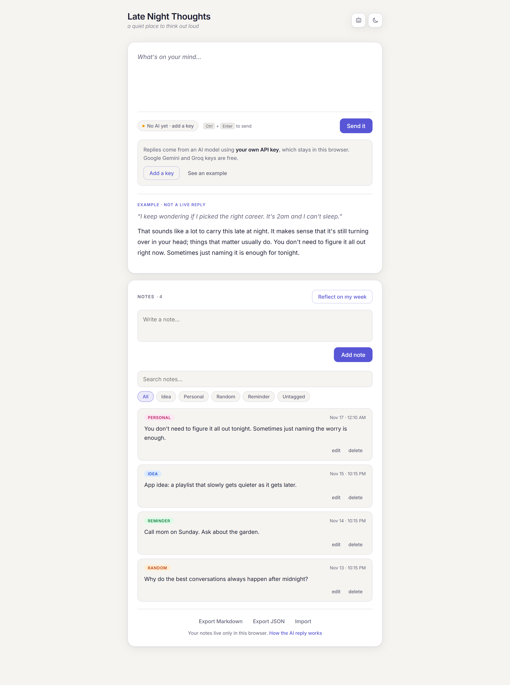

# Late Night Thoughts 🌙

[](https://github.com/Schmuchzyy/LateNightThoughts/actions/workflows/ci.yml)

A quiet place to think out loud. Write down what's keeping you up, and a calm, grounded AI friend writes back in a few honest sentences. No toxic positivity, no hype. Save the thoughts worth keeping as tagged notes, and once a week ask it to reflect on what you wrote.

**Live: [latenightthoughts.vercel.app](https://latenightthoughts.vercel.app)** · works on phone and desktop, installable, no sign-up. Notes work straight away. For AI replies, paste your own key (Google Gemini and Groq keys are free), or tap **See an example** to see what a reply looks like.



<p align="center">
  
  &nbsp;
  
</p>

## What it does

- **A calm reply, streamed as it's written,** from the AI provider you choose with your own key. The key stays in your browser.
- **Optional free demo mode:** if the site owner sets a server-side `GEMINI_API_KEY`, visitors can try it without a key. A small serverless function forwards the thought to Gemini with rate limits. The public deployment runs without it, and the app shows a clearly labelled example reply instead.
- **Bring your own key** for 11 providers: Anthropic, OpenAI, Google, xAI, DeepSeek, Groq, Mistral, Perplexity, Together, OpenRouter, or any OpenAI-compatible endpoint (including a local model).
- **A model picker that doesn't go stale:** each provider gets a short list of current models with plain labels ("fastest, cheapest", "most capable"). **Load models from your account** fetches the live list from the provider, and **Custom model ID…** takes any model.
- **Test connection** checks your key and model with a tiny request before you save. When something fails, errors say what to do next: wrong key, unknown model, out of credit or rate limited. Each reply is labelled with the model that actually wrote it.
- **Installable and works offline:** add it to your home screen like an app. Your notes open and save without a connection; only the AI reply needs one.
- **Notes that stay useful:** tags, filter by tag, live search with highlighting, inline editing, and undo after delete.
- **Reflect on my week:** a gentle summary of the notes you saved in the last 7 days, with one question to sit with.
- **Export and import** as Markdown (readable, and round-trips back in) or JSON.
- **Light and dark themes**, keyboard shortcuts (<kbd>Ctrl</kbd>+<kbd>Enter</kbd> to send or save) and accessible dialogs (focus trap, <kbd>Esc</kbd> to close, focus goes back to where you were).

## Privacy and API keys

| What | Where it goes |
|---|---|
| Your notes | Only this browser's `localStorage`. Nothing is uploaded. Export them to back them up. |
| Free demo replies (only if enabled) | Your thought (or, for "Reflect on my week", that week's notes) goes to this site's `/api/reflect` function, which forwards it to Google Gemini and doesn't store it. The demo uses Gemini's free tier, where Google may use prompts to improve its products. Use your own key if that matters to you. |
| Your own API key | Stays in your browser and is sent **only** to the provider you picked, straight from your browser. It never touches this site's server. By default it lives in `sessionStorage` and is forgotten when you close the tab. Tick "Remember my keys on this device" to keep it in `localStorage`, and use "Forget all saved keys" to wipe it. |

The site owner's Gemini key is a server-side environment variable. It is never sent to the browser and isn't in this repo.

**Abuse limits on the demo:** about 8 requests a minute and 40 a day per IP, a 2,000-character limit per thought (8,000 for the weekly reflection), capped reply length, and same-origin requests only. On Vercel, a WAF rate-limit rule on `/api/reflect` backs this up at the edge. If the free quota runs out, the function moves to the next model in `DEMO_MODELS`. When every model is exhausted, the app says so and suggests adding your own key.

## How it's built

- `index.html`: the whole app. Plain HTML, CSS and JavaScript, with no framework and no build step.
- `api/reflect.js`: a Vercel serverless function (Node, no dependencies). `GET` reports whether the demo is available. `POST {mode, text}` streams a plain-text reply from Gemini's `streamGenerateContent` endpoint and falls back through a list of models.
- `sw.js` and `manifest.webmanifest`: the installable, offline-first PWA. Pages load from the network first and fall back to the cache; AI calls are never cached.
- `vercel.json`: security headers (CSP, no framing, no referrer).
- `tests/`: Node's built-in test runner, no dependencies. Covers the demo function (streaming, model fallback, rate limits, input checks, origin check) plus checks that the app script parses, every input has a label, and no API keys are committed. GitHub Actions runs them on Node 20 and 22 for every push and PR.
- `dev-server.mjs`: a tiny local server that serves the page and runs the function the same way Vercel does.

Every provider is called with streaming on, and the reply renders as it arrives. The Gemini key goes in the `x-goog-api-key` header, never in the URL.

## Run it locally

You need Node 20 or newer.

```bash
git clone https://github.com/Schmuchzyy/LateNightThoughts.git
cd LateNightThoughts
```

```bash
npm run dev:mock
```

That runs the app at http://localhost:3000 with a canned demo reply, so you need no key. To use real Gemini replies, copy `.env.example` to `.env.local`, add your key from [Google AI Studio](https://aistudio.google.com/apikey), then:

```bash
npm run dev
```

You can also open `index.html` straight from disk and use your own key. Demo mode needs the server.

Run the tests:

```bash
npm test
```

## Deploy your own

1. Import the repo into [Vercel](https://vercel.com/new). There's nothing to configure, since it's a static page plus one function.
2. Under **Settings → Environment Variables**, add `GEMINI_API_KEY`. Optionally add `DEMO_MODELS`, a comma-separated fallback list that defaults to `gemini-3.5-flash-lite,gemini-3.1-flash-lite,gemini-2.5-flash-lite`.
3. Redeploy. Optionally add a WAF rate-limit rule for `/api/reflect` under **Firewall**.

Without `GEMINI_API_KEY` the app still works fully with visitors' own keys. The demo option is greyed out, and new visitors see a short "add a key / see an example" prompt.
